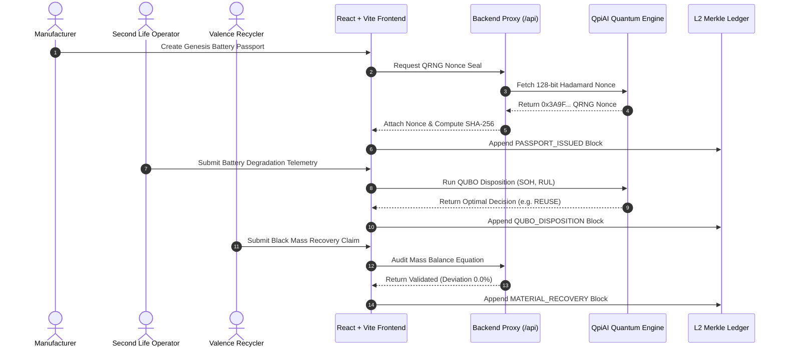

<div align="center">

# ⚡ REMIX CHAIN OF PROOF
### Enterprise Web3 EV Battery Passport, Disposition Optimization & QpiAI Engine

<p align="center">
  
</p>

<br/>

[](https://ais-pre-7yhp4py2j2cmcsfcthfx5x-121405157379.asia-southeast1.run.app)
[](https://ais-dev-7yhp4py2j2cmcsfcthfx5x-121405157379.asia-southeast1.run.app)
[](https://sir-shine-evanescence-relocation.trycloudflare.com)

<br/>


<br/>

> **Role-aware EV battery passport, disposition lifecycle tracking, and cryptographically verifiable material recovery audit platform powered by QpiAI Quantum Computing, QCloud 128-bit QRNG Nonces, and EU Battery Directive 2023/1542 Compliance Engines.**

[🌐 View Live Deployment](https://ais-pre-7yhp4py2j2cmcsfcthfx5x-121405157379.asia-southeast1.run.app) • [🛠️ Open Dev Studio](https://ais-dev-7yhp4py2j2cmcsfcthfx5x-121405157379.asia-southeast1.run.app) • [📖 Quantum Architecture](#-qpiai-ecosystem-deep-dive)

---

</div>

<br/>

## 🌟 Executive Overview & Unique Selling Propositions (USPs)

**Remix Chain of Proof** bridges the physical world of EV battery manufacturing and recycling with immutable Web3 ledger auditability and **QpiAI Quantum Computing**. As electric vehicle adoption scales globally, tracking battery lifecycle health, end-of-first-life (EoL) cascade decisions, material mass recovery, and carbon intensity becomes legally mandatory under the **EU Battery Directive 2023/1542**.

### 🚀 Key Platform USPs

| USP Feature | Traditional Battery Systems | Chain of Proof + QpiAI Platform |
| :--- | :--- | :--- |
| **EoL Cascade Decision Making** | Heuristic rules / Manual inspection | **QpiAI Opt QUBO Quantum Solver** optimizing SOH, impedance, remaining useful life, and market demand in <90ms |
| **Cryptographic Security** | Pseudo-random seeds / Static tokens | **QCloud 128-bit Quantum Random Number Generator (QRNG)** with Hadamard state superposition seals |
| **Material Mass Audit** | Self-reported Excel / Paper manifests | **Real-time Mass Conservation Engine** auditing input mass vs. recovered Lithium/Nickel/Cobalt/Black Mass |
| **Recycling Logistics** | Suboptimal static routing | **Stage 2 QUBO Multi-Facility Fleet Dispatch** minimizing transport emissions and processing costs |
| **Data Integrity & Tamper Testing** | Vulnerable centralized DBs | **Immutable Merkle L2 SHA-256 Ledger** with real-time interactive tamper simulation and 1-click repair |
| **Compliance & Regulation** | Manual audit preparation | **Automated EU Battery Directive 2023/1542** passport genesis and ESG claim validation |

---

## 🔮 QpiAI Ecosystem Deep Dive

```
 ┌─────────────────────────────────────────────────────────────────────────────────────────────┐
 │                                QPIAI QUANTUM & AI INTEGRATION ARCHITECTURE                   │
 ├─────────────────────────────────────────────────────────────────────────────────────────────┤
 │                                                                                             │
 │   ┌─────────────────────────────────────────────────────────────────────────────────────┐   │
 │   │                              1. QPIAI QCLOUD HARDWARE                               │   │
 │   │  • 128-bit Quantum Random Number Generator (QRNG) powered by Hadamard Superposition │   │
 │   │  • Generates unforgeable quantum nonces for every passport update & L2 block seal   │   │
 │   └──────────────────────────────────────────┬──────────────────────────────────────────┘   │
 │                                              │                                              │
 │                                              ▼                                              │
 │   ┌─────────────────────────────────────────────────────────────────────────────────────┐   │
 │   │                           2. QPIAI OPT SDK & QUBO SOLVER                            │   │
 │   │  • QpiAI-QOpt-MILP-v3.2 Hybrid Quantum-Inspired Heuristic Optimization Engine        │   │
 │   │  • Stage 1: Battery EoL Disposition Matrix (Direct Reuse vs. Repurpose vs. Recycle)│   │
 │   │  • Stage 2: Multi-Facility Supply Chain & Hydromet Fleet Dispatch Optimization     │   │
 │   └──────────────────────────────────────────┬──────────────────────────────────────────┘   │
 │                                              │                                              │
 │                                              ▼                                              │
 │   ┌─────────────────────────────────────────────────────────────────────────────────────┐   │
 │   │                            3. QPIAI API SERVICE PROXY                               │   │
 │   │  • Python FastAPI / Express REST API proxy layer with silent fallback mode          │   │
 │   │  • Connects Web3 Smart Contracts (Solidity) with QCloud Verification Endpoints      │   │
 │   │  • Active Endpoint: https://sir-shine-evanescence-relocation.trycloudflare.com     │   │
 │   └─────────────────────────────────────────────────────────────────────────────────────┘   │
 └─────────────────────────────────────────────────────────────────────────────────────────────┘
```

### 1. QpiAI API (REST & Microservice Protocol)
The platform communicates with the QpiAI Python FastAPI microservice backend (`/api/qubo/*`, `/api/reconciliation/*`, `/api/ledger/*`) to execute high-throughput optimization routines and cryptographic verifications.

* **`/api/qubo/disposition`** `[POST]`: Submits battery state telemetry vectors (SOH, C-rate, internal resistance, temperature delta) and retrieves optimal decision assignments.
* **`/api/qubo/dispatch`** `[POST]`: Calculates optimal recycling facility routing for bulk battery batches.
* **`/api/qubo/scale-test`** `[GET]`: Benchmark endpoint running stress tests across 100+ simultaneous battery packs.
* **`/api/reconciliation/claim`** `[POST]`: Validates physical black mass recovery claims against passport baseline expectations anchored with a QCloud QRNG nonce.

### 2. QpiAI SDK & QUBO Solver Engine
The **QpiAI Opt Solver (`QpiAI-QOpt-MILP-v3.2`)** solves Quadratic Unconstrained Binary Optimization problems expressed in Quadratic Hamiltonian matrix form:

$$\min_{x \in \{0,1\}^n} \quad H(x) = \sum_{i=1}^{n} Q_{ii} x_i + \sum_{1 \le i < j \le n} Q_{ij} x_i x_j$$

#### Stage 1: Battery EoL Cascade Disposition Model
For each degraded pack $k$, binary decision variables represent $x_{k,1}$ (Direct Grid BESS Reuse), $x_{k,2}$ (Repurpose to Commercial Backup), and $x_{k,3}$ (Hydromet Recycling):

$$\text{Subject to:} \quad \sum_{m=1}^{3} x_{k,m} = 1 \quad \forall k$$

The diagonal weights $Q_{ii}$ encode:
* State of Health ($\text{SOH}$) & Remaining Useful Life ($\text{RUL}$)
* Internal short circuit thermal runaway risk scores
* Market demand index & current raw material spot prices ($\text{Li}$, $\text{Ni}$, $\text{Co}$)

#### Stage 2: Multi-Facility Fleet Dispatch Model
Optimizes logistics route assignments to refiners $\mathcal{F} = \{\text{Alpha}, \text{Beta}, \text{Gamma}\}$ minimizing transport $\text{CO}_2$ emissions and processing fees subject to facility intake capacities.

### 3. QCloud 128-bit Quantum Random Number Generator (QRNG)
Security nonces are generated by measuring quantum superposition states in Hadamard bases:

$$|\psi\rangle = H|0\rangle = \frac{1}{\sqrt{2}}\left(|0\rangle + |1\rangle\right)$$

Sampling $128$ physical qubits produces a $128$-bit entropy source formatted as a 32-character hexadecimal nonce (e.g. `0x3A9F810C928378EF910A887C19283711`). This nonce is injected into the Solidity smart contract modifier:

```solidity
// Deep Security Guard tying Smart Contract execution to QpiAI QCloud QRNG Nonce
function updateBatterySOH(
    string memory batteryId,
    bytes32 _dataHash,
    string memory _qpiaiNonce
) external onlyAuthorized {
    require(bytes(_qpiaiNonce).length > 0, "SECURITY: MISSING QRNG NONCE");
    batteryHistory[batteryId].push(BatteryUpdate({
        dataHash: _dataHash,
        qpiaiNonce: _qpiaiNonce,
        timestamp: block.timestamp
    }));
    emit SOHUpdated(batteryId, _dataHash, _qpiaiNonce);
}
```

---

## 👥 Core Industry Personas & Access Control

The UI seamlessly toggles between **3 core industry roles**, filtering authorized modules and data context in real time:

```
                          ┌───────────────────────────┐
                          │   CHAIN OF PROOF SYSTEM   │
                          └─────────────┬─────────────┘
                                        │
         ┌──────────────────────────────┼──────────────────────────────┐
         │                              │                              │
         ▼                              ▼                              ▼
┌──────────────────┐          ┌──────────────────┐          ┌──────────────────┐
│MANUFACTURER (OEM)│          │ SECOND LIFE OPER │          │RECYCLER (VALENCE)│
├──────────────────┤          ├──────────────────┤          ├──────────────────┤
│• Mint Genesis    │          │• Ingest SOH      │          │• Hydromet Process│
│• Batch QRNG Sign │          │• QUBO Disposition│          │• Mass Balance    │
│• Passport Studio │          │• Dispatch Route  │          │• Audit Claims    │
└──────────────────┘          └──────────────────┘          └──────────────────┘
```

1. **Manufacturer (OEM)**:
   * Mints initial Genesis Battery Passports compliant with EU 2023/1542.
   * Signs baseline material compositions (Lithium, Nickel, Cobalt, Manganese) with QCloud QRNG nonces.
   * Key Modules: `Dashboard`, `Passport Studio`, `Chain Explorer`.

2. **Second Life Operator**:
   * Collects real-time battery degradation telemetry during operational service.
   * Triggers the QpiAI Opt QUBO engine to determine optimal EoL cascade disposition.
   * Key Modules: `Disposition Console`, `Passport Studio`, `Dashboard`.

3. **Recycler (Valence Refiner)**:
   * Executes hydrometallurgical refining and black mass reclamation.
   * Performs material mass balance verification ($M_{\text{in}} = M_{\text{out}}$).
   * Validates or rejects auditor claims on L2 ledger.
   * Key Modules: `Recycling Hub`, `Reconciliation`, `Chain Explorer`.

---

## 🧮 Mass Conservation Audit Engine

Under EU Battery Regulations, recyclers must prove high recovery efficiencies for critical raw materials. Chain of Proof implements a live mass conservation solver:

$$M_{\text{Battery Total}} = M_{\text{Lithium}} + M_{\text{Nickel}} + M_{\text{Cobalt}} + M_{\text{Manganese}} + M_{\text{Black Mass Slag}} + \Delta M$$

$$\text{Deviation Percentage } (\delta) = \left| \frac{M_{\text{Claimed}} - M_{\text{Genesis Baseline}}}{M_{\text{Genesis Baseline}}} \right| \times 100\%$$

* If $\delta \le 5.0\% \implies$ **VALIDATED** (Stamped with QCloud QRNG Seal).
* If $\delta > 5.0\% \implies$ **REJECTED / BLOCKED** (Escalated to Auditor Dashboard).

---

## 🖥️ Interactive Platform Modules

```
 ┌───────────────────┬────────────────────────────────────────────────────────────────────────┐
 │ MODULE            │ KEY CAPABILITIES                                                       │
 ├───────────────────┼────────────────────────────────────────────────────────────────────────┤
 │ Dashboard         │ Ecosystem KPIs, total active claims, QpiAI connectivity status, role.  │
 │ Passport Studio   │ 3-column layout, horizontal lifecycle timeline, material progress bars.│
 │ Disposition       │ Matrix weight tuner, QpiAI QUBO 2-stage solver, decision assignments.   │
 │ Recycling Hub     │ Hydromet batch manager, black mass efficiency charts, ESG metrics.    │
 │ Reconciliation    │ Human-readable genesis vs. claim comparison, cryptographic validator. │
 │ Chain Explorer    │ Block inspector, Merkle proof tree, interactive Tamper & Repair tool.   │
 └───────────────────┴────────────────────────────────────────────────────────────────────────┘
```

---

## ⚙️ System Architecture & Data Flow



---

## 🛠️ Local Developer Setup

### Prerequisites
* **Node.js**: `v18.0.0` or higher
* **npm**: `v9.0.0` or higher

### Step-by-Step Installation

```bash
# 1. Clone repository
git clone https://github.com/your-org/chain-of-proof.git
cd chain-of-proof

# 2. Install all dependencies
npm install

# 3. Start local development server (Express backend + Vite frontend)
npm run dev
# Server listening on http://localhost:3000

# 4. Run TypeScript compilation check
npm run build
```

---

## 🎨 Design System Specs

* **Theme**: Deep Industrial Dark Mode
* **Background Colors**: Midnight Black (`#0B0E14`), Charcoal Navy (`#121721`)
* **Primary Accents**: Cobalt Blue (`#3B82F6` / `#2563EB`)
* **Quantum Accents**: Acid Lime (`#A3E635` / `#84CC16`)
* **Status Badges**: Emerald Green (`#10B981`), Amber Warning (`#F59E0B`), Rose Alert (`#F43F5E`)
* **Typography**:
  * Body Text & UI Labels: `Inter`, `-apple-system`, `sans-serif`
  * Values, Nonces, Hashes & Code Snippets: `JetBrains Mono`, `monospace`

---

## 📜 Compliance & Standard Certifications

- **EU Battery Directive 2023/1542**: Passport genesis structure, carbon intensity tracking, and recycled material thresholds.
- **ISO 26262**: Functional safety diagnostic data structures.
- **IEEE 2413**: Architectural framework for Internet of Things (IoT) battery telemetry.

---

<div align="center">

**Built for the future of sustainable circular battery value chains with QpiAI Engine.**

[▲ Back to top](#-remix-chain-of-proof)

</div>
